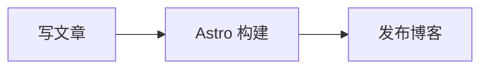

# 西贝的代码宇宙

个人博客。记录后端、分布式系统、AI 与开源项目，也写天文和业余无线电。

站点：<https://mrsibe.top> · 友链申请：[Issue #1](https://github.com/MrSibe/blog/issues/1)

## 技术栈

- [Astro](https://astro.build) 6 + [astro-theme-pure](https://github.com/cworld1/astro-theme-pure)
- 包管理与脚本：bun
- 搜索：[Pagefind](https://pagefind.app/)（构建时生成索引）
- 图表：Mermaid（浏览器本地渲染，无需外部服务）
- 公式：KaTeX
- 文章分享图：`astro-og-canvas`，构建时按文章生成 `/og/<文章路径>.png`
- 中文字体：Noto Sans SC Variable（[Fontsource](https://fontsource.org/fonts/noto-sans-sc) 自托管，OFL 许可）
- 部署：Cloudflare Pages（静态输出）

## 本地开发

> 工具链统一使用 Bun 1.4.3（`packageManager` 字段已固定）。`bun.lock` 是 lockfile v2 格式，低于 Bun 1.3 的版本无法解析。

```bash
bun install
bun run dev        # http://localhost:4321
bun run build      # astro-pure check + astro check + astro build
bun run preview    # 预览构建产物
```

## 写文章

文章放在 `src/content/blog/`，**文件路径即 URL**：`godis/1-resp-protocol.md` → `/blog/godis/1-resp-protocol`。

```bash
bun run pure new <post-slug>
```

frontmatter 必填 `title`、`description`、`publishDate`，可选 `updatedDate`、`tags`、`draft`、`heroImage`、`pin`。

站点配置在 `src/site.config.ts`（标题、导航、页脚、友链申请信息等）。

没有评论系统：`integ.waline.enable` 保持 `false`。

## 图表与分享图

### Mermaid

文章中使用 `mermaid` 代码块即可生成流程图、架构图和时序图：

````markdown

````

图表使用适配明暗背景的中性主题，渲染在浏览器本地完成。

### 自动 OG 图片

构建时为每篇已发布文章生成 `/og/<文章路径>.png`（1200 × 630），并写入 Open Graph、Twitter Card。中文字体随仓库提供（`src/assets/fonts/NotoSansSC-Regular.otf`，来自 [Noto CJK](https://github.com/notofonts/noto-cjk)，许可证见同目录 `OFL.txt`）。站点默认分享图由 `scripts/make-social-card.mjs` 生成。

## 死链检查

[Check Links 工作流](.github/workflows/links.yml) 使用 Lychee 检查文章与 README 中的外部 HTTP(S) 链接：内容变更时运行，每周一 UTC 02:00 定时运行，也可手动触发。失效链接会使检查失败，报告显示在该次运行的 Job Summary 中。

配置位于 `lychee.toml`；仅排除示例域名与私网地址，不会把 403 / 429 等错误直接当作成功。新增排除项前应先确认是站点反爬限制，而非真正失效。

## 收录与部署

部署在 Cloudflare Pages（静态输出）。构建前需要在 Pages 项目里设置 Bun 版本，否则会用构建镜像自带的 Bun 1.2.15，无法解析 lockfile v2：

> Workers & Pages → 该项目 → **Settings → Environment variables** → 添加构建变量 `BUN_VERSION=1.4.3`（Production 与 Preview 都加），然后重新部署。
> Bun 的版本只能用 `BUN_VERSION` 覆盖，Cloudflare 不支持通过项目内文件固定 Bun 版本。

- `public/_redirects`：旧站（Fuwari）URL 到新 URL 的 301 映射。
- `public/_headers`：CDN 缓存策略。
- `public/1383de5cca6bb0c559a90d754e7ec30a.txt`：IndexNow 密钥，[IndexNow 工作流](.github/workflows/indexnow.yml) 在部署后提交 `sitemap-0.xml`。

## 迁移记录

本站由旧的 Fuwari 站点迁移而来，旧仓库历史保留在 `legacy-fuwari` 分支。

- `scripts/migrate-old-blog.mjs`：把旧站 `src/content/posts/**` 转成新站的 frontmatter（`published` → `publishDate`、`category` 并入 `tags`、`Java` 代码围栏改小写等）。
- `scripts/make-social-card.mjs`：生成站点默认分享图。

## 许可

博客内容版权归作者所有（CC BY-NC-SA 4.0）；站点基于 MIT 许可的 [astro-theme-pure](https://github.com/cworld1/astro-theme-pure) 构建。
